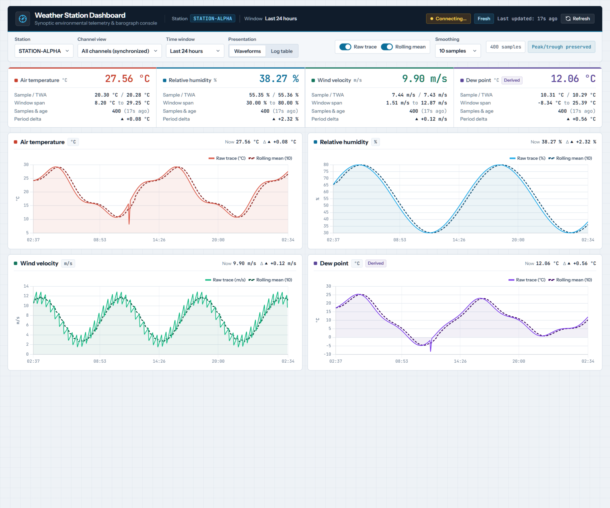
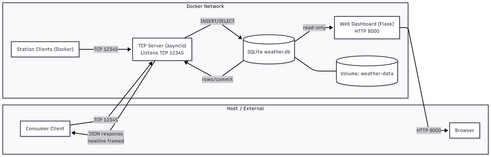
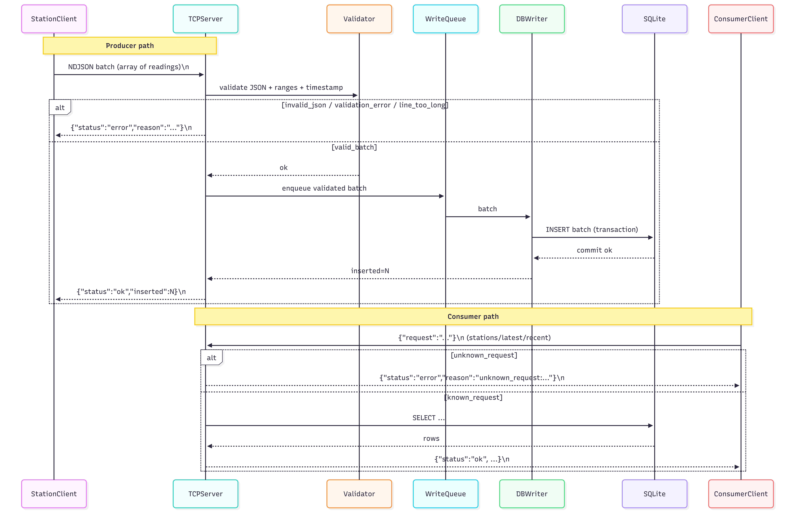

# Weather Station Simulator: Distributed Telemetry Ingestion Platform

[](https://github.com/GPapazachariou/weather-station/actions/workflows/ci.yml)
[](https://www.python.org/)
[](tests/)
[](https://github.com/astral-sh/ruff)
[](LICENSE)

## 1. Project Overview

The **Weather Station Simulator** is a distributed, real-time telemetry ingestion platform demonstrating asynchronous TCP socket networking, strict protocol validation, high-concurrency persistence, and live web visualization. Multiple weather station clients continuously stream sensor readings (temperature, humidity, windspeed) over TCP to a central `asyncio` server. The server validates newline-delimited JSON (NDJSON) batches atomically, persists data in SQLite via a serialized single-writer queue, and serves a live web dashboard and REST API. Consumer clients can also query the server for real-time station data over the same multiplexed TCP stream.

**Key characteristics:**
- **Resilient multi-client architecture:** Weather station clients feature jittered exponential backoff, bounded FIFO local buffering, and zero-config hostname-based station identification.
- **Asyncio TCP server:** Handles concurrent client connections with a dedicated single-writer queue to eliminate SQLite write-lock contention.
- **Multiplexed NDJSON protocol:** Supports both producer batch ingestion and consumer read-only queries (`stations`, `latest`, `recent`) on a single TCP port.
- **Containerized deployment:** Multi-container Docker Compose orchestration with health checks, named volume persistence, and horizontal scaling support (`--scale station=100`).
- **Interactive Web UI:** Flask + Chart.js dashboard reading SQLite in read-only/WAL mode for live time-series visualization and statistical aggregations.



---

## 2. Architecture at a Glance

| Component | Role | Port | Technology |
|-----------|------|------|------------|
| **TCP Server** | Listens for NDJSON batches & consumer requests; validates & persists to SQLite | `12345` | Python `asyncio` + `aiosqlite` |
| **Weather Station Client(s)** | Generate sensor readings; send NDJSON batches; buffer & auto-reconnect on failure | (connects to `12345`) | Python `asyncio` (stdlib) |
| **Web UI** | Serves interactive HTML dashboard + REST API for metrics visualization | `8000` | Flask + Chart.js + SQLite |
| **Consumer Client** | Verification harness sending read-only TCP queries (`stations`/`latest`/`recent`) | (connects to `12345`) | Python `asyncio` |

**Data flow diagram:**

```
┌────────────────────────────────────────────────────────────────┐
│                    WEATHER STATION SIMULATOR                   │
├────────────────────────────────────────────────────────────────┤
│                                                                │
│  [STATION-001]  [STATION-002]  [STATION-003]  [STRESS-NNN]     │
│       │               │              │              │          │
│       └───────────────┴──────────────┴──────────────┘          │
│                       │                                        │
│                       │ NDJSON Batch (JSON list)               │
│                       │ TCP :12345                             │
│                       ▼                                        │
│          ┌─────────────────────────────┐                       │
│          │   TCP Server (asyncio)      │                       │
│          │ • Parse & validate batch    │                       │
│          │ • Multiplexed producer/     │                       │
│          │   consumer requests         │                       │
│          └─────────────────────────────┘                       │
│                       │                                        │
│                       │ Single Writer Queue                    │
│                       │ (avoid DB lock contention)             │
│                       ▼                                        │
│          ┌─────────────────────────────┐                       │
│          │   SQLite Database Volume    │                       │
│          │   /app/data/weather.db      │                       │
│          │ (WAL mode, PRAGMA tuned)    │                       │
│          └─────────────────────────────┘                       │
│                  ▲          │                                  │
│     SELECT       │          │ SELECT                           │
│     (read-only)  │          │ (read-only)                      │
│                  │          ▼                                  │
│          ┌─────────────────────────────┐                       │
│          │   Flask Web Dashboard       │                       │
│          │   :8000/api/stations        │                       │
│          │   :8000/api/stats           │                       │
│          │   :8000/api/readings        │                       │
│          │   :8000/ (HTML UI)          │                       │
│          └─────────────────────────────┘                       │
│                                                                │
│          ┌─────────────────────────────┐                       │
│          │   Consumer Client (test)    │                       │
│          │ • {"request":"stations"}    │                       │
│          │ • {"request":"latest"}      │                       │
│          │ • {"request":"recent"}      │                       │
│          └─────────────────────────────┘                       │
│                       │                                        │
│     JSON Request      │                                        │
│     TCP :12345        │                                        │
│                       ▼                                        │
│             TCP Server (read-only path)                        │
│                                                                │
└────────────────────────────────────────────────────────────────┘
```

### Component & Message Flow Diagrams





---

## 3. Requirements

### Docker + Docker Compose
- **Docker Desktop** (Windows/macOS) or **Docker Engine + Docker Compose** (Linux)
- Minimum: Docker Engine 20.10+, Docker Compose 2.0+

### Python (for running tests/clients locally, optional)
- Python 3.11+ recommended (tested across 3.11, 3.12, and 3.13 in CI)
- See [`requirements-dev.txt`](requirements-dev.txt), [`server/requirements.txt`](server/requirements.txt), [`web/requirements.txt`](web/requirements.txt), and [`station_client/requirements.txt`](station_client/requirements.txt)

---

## 4. Quick Start (Recommended: Docker Compose)

### 4.1 Build and Run the Stack

**On Windows (PowerShell) or macOS/Linux:**
```bash
# Start all services (server + 3 station clients + web UI)
docker compose up --build
```

What happens:
1. Docker builds images for the TCP server, station clients, and web UI.
2. Services start: TCP server (port `12345`), 3 station clients (`STATION-001`, `STATION-002`, `STATION-003`), and web UI (port `8000`).
3. Weather data flows: stations send batches every 5 seconds → server validates & writes → SQLite.
4. Logs stream to the terminal.

### 4.2 View Logs

**Watch server activity:**
```bash
docker compose logs -f server
```

**Watch a specific station:**
```bash
docker compose logs -f station-001
```

**Watch all services:**
```bash
docker compose logs -f
```

### 4.3 Open the Web Dashboard

1. Wait 10–15 seconds for the server health check to pass and data to start flowing.
2. Open browser: **http://localhost:8000**
3. You should see:
   - **Station Selector:** Seamless switching between all active stations.
   - **Aligned Multi-Panel Exploration:** Simultaneous time-series panels for Temperature (°C), Humidity (%), and Wind Speed (m/s) with aligned time axes, synchronized tooltips, and consistent color palettes.
   - **Intuitive Time-Range Controls:** Explore `1h`, `6h`, `24h`, `7d`, `30d`, `All History`, or `Last N Values` (10 to 1000).
   - **Raw vs. Rolling Averages:** Independent toggles and configurable rolling window (3 to 30) with distinct visual styles.
   - **Missing Data Gaps:** Offline periods and missing intervals are explicitly rendered as visible breaks rather than misleading interpolated lines.
   - **Peak & Trough Preserving Downsampling:** Large historical datasets are downsampled with an extrema-preserving bucket algorithm, keeping charts responsive while preserving significant spikes and labeling aggregated buckets in tooltips.
   - **Full-Dataset Summary Statistics:** Latest, Average, Minimum, and Maximum values computed directly from the 100% full selected dataset in SQLite.
   - **Live Telemetry Stream:** Real-time updates via Server-Sent Events (SSE) without full page reloads.

### 4.4 Run the High-Concurrency Stress Stack (Optional)

You can stress test the platform with high-frequency ingestion and horizontal scaling using [`docker-compose.stress.yml`](docker-compose.stress.yml). Each station replica automatically uses its container `HOSTNAME` as its unique station ID:

```bash
# Run stress stack with default replica count or scale dynamically to 100 concurrent stations
docker compose -f docker-compose.stress.yml up --build --scale station=100
```

### 4.5 Stop and Clean Up

**Stop all services (keeps data/volume):**
```bash
docker compose down
```

**Stop all services and delete volume (fresh start next time):**
```bash
docker compose down -v
```

*(If running the stress stack, append `-f docker-compose.stress.yml` to `down` or `down -v`.)*

---

## 5. Live Demo Script (5–10 minutes)

Follow this sequence for a complete walkthrough of the system:

### Step 1: Start services
```bash
docker compose up --build
```
Wait ~15 seconds for health checks and initial batches to be inserted.

### Step 2: Monitor server logs
```bash
# In a new terminal
docker compose logs -f server
```
You should see entries like:
```
Database initialized: /app/data/weather.db
Client connected: <IP>
Processed producer batch from <IP>: STATION-001, 1 readings inserted
...
```

### Step 3: Open web dashboard
- Navigate to **http://localhost:8000**
- Demonstrate:
  - Stations list is populated (`STATION-001`, `STATION-002`, `STATION-003`)
  - Select a station and metric (e.g., `STATION-001`, Temperature)
  - Charts update in real time every 5 seconds
  - Switch between time windows (e.g., 6-hour, 24-hour, or Last N readings)
  - Stats panel shows latest, average, min, and max values

### Step 4: Run consumer protocol tests
```bash
# In a new terminal, navigate to project directory
python consumer_client/test_consumer.py
```

Expected output (all 8 tests pass):
```
==================================================
Weather Station Consumer Tests
==================================================
Server: localhost:12345

=== Test 1: Producer Batch Ingest ===
  Response: {"status": "ok", "inserted": 2}
  ✓ Producer batch ingest successful: 2 readings inserted

=== Test 2: Consumer Request - Stations ===
  Response: {"status": "ok", "stations": ["STATION-001", "STATION-002", "STATION-003"]}
  ✓ Consumer stations request successful: ['STATION-001', 'STATION-002', 'STATION-003']

=== Test 3: Consumer Request - Latest (All Stations) ===
  Response: {"status": "ok", "reading": {...}}
  ✓ Consumer latest request successful

=== Test 4: Consumer Request - Latest (Specific Station) ===
  Response: {"status": "ok", "reading": {...}}
  ✓ Consumer latest station request successful

...

==================================================
Results: 8/8 tests passed
==================================================
```

### Step 5: Demonstrate horizontal scaling stress test (optional)
```bash
# Launch 100 concurrent station replicas streaming rapid batches
docker compose -f docker-compose.stress.yml up --build --scale station=100
```

---

## 6. How to Run Without Docker (Optional)

If you want to run components directly on the host for local development:

### 6.1 Prerequisites
- Python 3.11+
- SQLite (included with Python stdlib)

### 6.2 Setup Environment

**Windows (PowerShell):**
```powershell
python -m venv .venv
.\.venv\Scripts\Activate.ps1
pip install -r requirements-dev.txt
```

**macOS/Linux:**
```bash
python3 -m venv .venv
source .venv/bin/activate
pip install -r requirements-dev.txt
```

### 6.3 Run Components

**Terminal 1: Start the server**
```bash
cd server
python app.py
```
Expected output:
```
Database initialized: /app/data/weather.db
Server listening on 0.0.0.0:12345
```

**Terminal 2: Start the web UI**
```bash
cd web
python web.py
```
Expected output:
```
 * Running on http://127.0.0.1:8000
```

**Terminal 3: Start a weather station client**
```bash
cd station_client
python client.py --station-id STATION-001 --host localhost --port 12345
```

**Terminal 4 (optional): Start another client**
```bash
cd station_client
python client.py --station-id STATION-002 --host localhost --port 12345
```

Then open **http://localhost:8000** in your browser.

---

## 7. Testing

### 7.1 Automated Unit & Integration Tests (pytest)

The project includes an automated test suite with CI matrix testing on Python 3.11, 3.12, and 3.13 via GitHub Actions.

**Run tests locally:**
```bash
# 1. Install development and runtime dependencies
pip install -r requirements-dev.txt

# Or install in editable mode with development extras:
# pip install -e ".[dev]"

# 2. Run full test suite with coverage
pytest

# 3. Run linter
ruff check .
```

**Test suite contents ([`tests/`](tests/)):**
- **[`test_protocol.py`](tests/test_protocol.py)**: Unit tests verifying measurement boundaries, NaN/Inf rejection, strict bool rejection, `station_id` sanitization (including non-ASCII rejection), ISO-8601 parsing, and all-or-nothing transactional batch rules (**100% coverage**).
- **[`test_web.py`](tests/test_web.py)**: API tests covering Flask routes, input validation (400 responses), regression safeguards for "Last N" chronological ordering, UTC cutoff windowing, and dynamic wind column detection (**99% coverage**).
- **[`test_server.py`](tests/test_server.py)**: Async tests verifying single-writer queue concurrency without SQLite lock contention, consumer protocol handlers (`stations`, `latest`, `recent`), and end-to-end TCP loopback communication.
- **[`test_client.py`](tests/test_client.py)**: Unit and lifecycle tests verifying sensor math, FIFO buffering, drop-oldest overflow logic, hostname fallback, and jittered exponential backoff.
- **[`test_smoke.py`](tests/test_smoke.py)**: Verifies packaging discovery and module imports across components.

### 7.2 Consumer Protocol Tests (Live Integration)

The [`consumer_client/test_consumer.py`](consumer_client/test_consumer.py) script validates producer batch ingest and consumer request paths against a running server.

**Run tests (server must be running):**
```bash
docker compose up -d
python consumer_client/test_consumer.py
```

**What it tests:**
1. Producer batch ingest: send 2 readings, verify `{"status": "ok", "inserted": 2}`
2. Consumer `stations` request: list all unique station IDs
3. Consumer `latest` request: get newest reading (all stations or filtered by `station_id`)
4. Consumer `recent` request: get last N readings with optional limit
5. Invalid request handling: verify unknown request types are rejected cleanly

### 7.3 API Sanity Check

**Test API endpoints directly (via `curl` or browser):**

```bash
# List stations
curl http://localhost:8000/api/stations
# Expected response:
# {"stations": ["STATION-001", "STATION-002", "STATION-003"]}

# Get stats for a station
curl "http://localhost:8000/api/stats?station_id=STATION-001&metric=temperature&range=24h"
# Expected response:
# {"latest": 22.5, "latest_t": "2025-01-17T14:30:45Z", "avg": 22.1, "min": 20.0, "max": 25.5}
```

---

## 8. Configuration

### 8.1 Environment Variables

**Server** ([`server/app.py`](server/app.py)):

| Variable | Default | Purpose |
|----------|---------|---------|
| `DB_PATH` | `/app/data/weather.db` | Path to SQLite database file. Inside Docker, points to the mounted volume. |
| `SERVER_HOST` | `0.0.0.0` | Bind address for the asyncio TCP server (configurable via environment variable). |
| `SERVER_PORT` | `12345` | TCP port for incoming station and consumer connections (configurable via environment variable). |
| `WRITE_QUEUE_MAX` | `500` | Maximum write queue depth before applying backpressure. |
| `WRITE_ENQUEUE_TIMEOUT` | `2.0` | Timeout in seconds waiting for queue space before returning `server_busy` backpressure. |
| `WRITE_ACK_TIMEOUT` | `5.0` | Timeout in seconds waiting for writer task acknowledgment before timing out. |

**Weather Station Client** ([`station_client/client.py`](station_client/client.py)):

| Variable | Default | Purpose | CLI Override |
|----------|---------|---------|---|
| `WEATHER_STATION_HOST` | `localhost` | Server hostname or IP (`server` in Docker Compose) | `--host` |
| `WEATHER_STATION_PORT` | `12345` | Server TCP port | `--port` |
| `WEATHER_STATION_ID` | `HOSTNAME` / system hostname (falls back to `NEW_STATION`) | Station identifier; defaults to container/system hostname for zero-config Docker Compose scaling | `--station-id` |
| `WEATHER_STATION_BATCH_MIN` | `1` | Minimum batch size (readings, must be positive and ≤ max) | `--batch-min` |
| `WEATHER_STATION_BATCH_MAX` | `1` | Maximum batch size (readings) | `--batch-max` |
| `WEATHER_STATION_BATCH_INTERVAL` | `5` | Seconds between batches | `--batch-interval` |
| `WEATHER_STATION_TIMEOUT` | `5.0` | Server ACK response timeout (seconds) | `--timeout` |
| `WEATHER_STATION_CONNECT_TIMEOUT` | `10.0` | TCP connection timeout (seconds) | `--connect-timeout` |

**Web UI** ([`web/web.py`](web/web.py)):

| Variable | Default | Purpose |
|----------|---------|---------|
| `WEATHER_DB_PATH` | `../data/weather.db` | Path to SQLite database. Inside Docker: `/app/data/weather.db` |
| `WEB_HOST` | `127.0.0.1` | Flask bind address (`0.0.0.0` in Docker Compose) |
| `WEB_PORT` | `8000` | Flask HTTP port |

### 8.2 Examples

**Example 1: Run a client with custom station ID and batch size**

```bash
python station_client/client.py --station-id WEATHER-LAB-01 --batch-min 5 --batch-max 10 --batch-interval 2
```

**Example 2: Run web UI on a different port**

```bash
export WEB_PORT=9000  # or $env:WEB_PORT=9000 in PowerShell
python web/web.py
# Then visit http://localhost:9000
```

---

## 9. Protocol Specification (Producer + Consumer)

### 9.1 Producer Batch (Client → Server)

**Format:** Newline-delimited JSON (NDJSON). Each line is a JSON array of reading objects.

**Message size:** Max 65,536 bytes per line.

**Batch size:** 1–50 readings per batch.

**Example batch:**
```json
[
  {
    "station_id": "STATION-001",
    "timestamp": "2025-01-17T14:30:45.123Z",
    "temperature": 22.5,
    "humidity": 58.3,
    "windspeed": 4.2
  },
  {
    "station_id": "STATION-001",
    "timestamp": "2025-01-17T14:30:50.456Z",
    "temperature": 22.6,
    "humidity": 58.1,
    "windspeed": 4.3
  }
]
```

**Field constraints:**
- `station_id`: Non-empty printable ASCII string, max 64 characters (e.g., `"STATION-001"`)
- `timestamp`: ISO 8601 format with `Z` or timezone offset (e.g., `"2025-01-17T14:30:45Z"`, `"2025-01-17T14:30:45+00:00"`)
- `temperature`: Finite number (`int` or `float`, booleans rejected), –10 to 40 °C
- `humidity`: Finite number, 0 to 100 %
- `windspeed`: Finite number, 0 to 50 m/s

**Server response (success):**
```json
{"status": "ok", "inserted": 2}
```

**Server response (error):**
```json
{"status": "error", "reason": "invalid_temperature at index 0 (expected -10..40)"}
```

---

### 9.2 Consumer Request (Client → Server)

**Format:** Newline-delimited JSON. Each line is a JSON object with a `"request"` key.

#### 9.2.1 Stations
List all unique station IDs in the database.

**Request:**
```json
{"request": "stations"}
```

**Response:**
```json
{"status": "ok", "stations": ["STATION-001", "STATION-002", "STATION-003"]}
```

#### 9.2.2 Latest
Get the newest reading (global or for a specific station).

**Request (all stations):**
```json
{"request": "latest"}
```

**Request (specific station):**
```json
{"request": "latest", "station_id": "STATION-001"}
```

**Response:**
```json
{
  "status": "ok",
  "reading": {
    "station_id": "STATION-001",
    "timestamp": "2025-01-17T14:30:50Z",
    "temperature": 22.6,
    "humidity": 58.1,
    "windspeed": 4.3
  }
}
```

**Response (no data):**
```json
{"status": "ok", "reading": null}
```

#### 9.2.3 Recent
Get the last N readings (global or for a specific station).

**Request (default limit 50):**
```json
{"request": "recent"}
```

**Request (custom limit & specific station):**
```json
{"request": "recent", "station_id": "STATION-001", "limit": 5}
```

**Response:**
```json
{
  "status": "ok",
  "readings": [
    {"station_id": "STATION-001", "timestamp": "2025-01-17T14:30:50Z", "temperature": 22.6, "humidity": 58.1, "windspeed": 4.3},
    {"station_id": "STATION-001", "timestamp": "2025-01-17T14:30:45Z", "temperature": 22.5, "humidity": 58.3, "windspeed": 4.2}
  ]
}
```

#### 9.2.4 Unknown Request
**Request:**
```json
{"request": "typo"}
```

**Response:**
```json
{"status": "error", "reason": "unknown_request:typo"}
```

---

## 10. Project Structure

```
weather-station/
├── README.md                          # Main project documentation & guide
├── LICENSE                            # MIT License
├── pyproject.toml                     # Python packaging, pytest, coverage & ruff config
├── requirements-dev.txt               # Development & test dependencies
├── docker-compose.yml                 # Main Compose stack (server + 3 stations + web)
├── docker-compose.stress.yml          # Stress Compose stack (horizontally scalable stations)
│
├── server/                            # Asyncio TCP Server
│   ├── Dockerfile
│   ├── app.py                         # Main server logic (asyncio + single-writer queue)
│   ├── protocol.py                    # Batch validation & protocol constants
│   └── requirements.txt               # Server dependencies (aiosqlite)
│
├── station_client/                    # Weather Station Client
│   ├── Dockerfile
│   ├── client.py                      # Client logic (backoff, buffering, sensor simulation)
│   └── requirements.txt               # Client dependencies (stdlib only)
│
├── web/                               # Flask Web Dashboard
│   ├── Dockerfile
│   ├── web.py                         # Flask application & REST API endpoints
│   ├── requirements.txt               # Web dependencies (Flask)
│   ├── templates/
│   │   └── index.html                 # Dashboard HTML template
│   └── static/
│       ├── app.js                     # Frontend logic (Chart.js, polling, rolling average)
│       └── styles.css                 # Responsive dashboard styling
│
├── consumer_client/                   # Consumer Protocol Verification Harness
│   └── test_consumer.py               # Live integration tests (producer + consumer protocol)
│
├── tests/                             # Automated Test Suite (pytest)
│   ├── test_protocol.py               # Protocol & boundary validation unit tests
│   ├── test_server.py                 # Async TCP server & single-writer tests
│   ├── test_web.py                    # Flask REST API & query windowing tests
│   ├── test_client.py                 # Client buffering, backoff & lifecycle tests
│   └── test_smoke.py                  # Module import & packaging smoke tests
│
├── scripts/                           # Operational & Verification Utilities
│   ├── gen_stress_compose.py          # Stress test Compose generator
│   └── verify_correctness_perf.py     # End-to-end correctness & throughput benchmark
│
├── docs/                              # Architecture & Codebase Documentation
│   ├── PROJECT_REVIEW.md              # Architecture & engineering quality review
│   ├── CODE_REVIEW.md                 # Codebase audit & technical findings
│   ├── diagrams/                      # Mermaid source diagrams
│   │   ├── architecture_component_view.md
│   │   └── sequence_message_flow.md
│   └── explanation/                   # Deep-dive per-file documentation
│       ├── INDEX.md                   # Documentation navigation hub
│       ├── 00_overview.md             # System architecture & data flow overview
│       ├── architecture-decisions.md  # Detailed design decisions & trade-offs
│       └── ...                        # Per-component code walkthroughs
│
└── screenshots/                       # UI & Architecture Visuals
    ├── 01_docker_compose.png
    ├── 02_docker_ps.png
    ├── 03_network_ls.png
    ├── 04_docker_logs.png
    ├── 05_web_ui.png
    ├── 06_architecture_components.png
    └── 07_message_flow.png
```

---

## 11. Reliability & Recovery

- **Server Restart & Persistence:** The Docker volume (`weather-data`) preserves SQLite data across container restarts. On startup, the server ensures the schema and indexes exist, enables WAL mode, and resumes accepting writes.
- **Client Resilience:** Clients automatically reconnect using exponential backoff with random jitter (`1s` base up to `60s` max). While disconnected, generated batches are stored in a bounded local FIFO buffer (dropping the oldest batches if capacity is exceeded) and flushed in order upon reconnection.
- **Stateless Web UI:** The Flask web application queries SQLite on each request and gracefully tolerates an empty or uninitialized database by returning empty lists/null metrics rather than 500 errors.
- **Transactional Consistency:** All-or-nothing batch validation ensures malformed readings never cause partial batch writes. On graceful shutdown, the single-writer task drains and flushes pending queue items before closing the database connection.

---

## 12. Troubleshooting

| Symptom / Issue | Cause | Solution |
|-----------------|-------|----------|
| **`bind: address already in use` (Port Conflicts)** | Another process is using port `12345` or `8000` | Stop conflicting services or modify published port mappings (`12345:12345`, `8000:8000`) in [`docker-compose.yml`](docker-compose.yml) / set `WEB_PORT` or `SERVER_PORT`. |
| **Web dashboard shows no stations** | Station clients haven't sent first batch yet, or server is unreachable | Wait 15–20 seconds after `docker compose up` for health checks and initial batches. Inspect logs via `docker compose logs server` and `docker compose logs station-001`. |
| **Consumer tests fail with `ConnectionRefusedError`** | TCP server is not listening on `localhost:12345` | Start the stack (`docker compose up -d` or `python server/app.py`) and verify with `docker compose ps`. |
| **Data disappears after restart** | Volume was removed with `-v` or `DB_PATH` points outside volume | Use `docker compose down` (without `-v`) to preserve data. Verify `weather-data` exists via `docker volume ls`. |
| **`database is locked` errors** | High concurrent write contention or external read/write lock on volume | Mitigated by the single-writer queue and SQLite WAL mode (`busy_timeout`). Verify only one server instance writes to the database file. |
| **Web UI stuck on loading or returns 500** | Web container cannot read `WEATHER_DB_PATH` | Check `docker compose logs web` and confirm `WEATHER_DB_PATH` matches the shared volume path (`/app/data/weather.db`). |
| **Dashboard slows down during 100-station stress test** | Large point counts rendered in browser or heavy disk I/O | Narrow the selected dashboard time window (e.g., 6h or Last N) or reduce `--scale station=N` replica count. |

---

## 13. Project Requirements & Engineering Highlights

- **Asynchronous Socket Ingestion:** Raw `asyncio` TCP server accepting newline-delimited JSON streams on port `12345`.
- **Single-Writer Concurrency Model:** Decouples network I/O coroutines from disk persistence via an `asyncio.Queue` and dedicated writer task, eliminating SQLite lock contention.
- **Strict Protocol Validation:** Enforces schema keys, finite numeric ranges (`math.isfinite`), strict boolean rejection, printable ASCII station IDs, ISO-8601 timestamps, batch size limits (1–50), and line byte limits (64 KB) prior to database insertion.
- **Durable Storage:** SQLite configured with Write-Ahead Logging (`PRAGMA journal_mode=WAL`) and composite indexing on `(station_id, timestamp)` stored in a shared Docker volume.
- **Multi-Metric Telemetry:** End-to-end support for temperature, humidity, and windspeed across protocol validation, SQLite storage, REST API aggregations, and Chart.js visualization.
- **Container Orchestration:** Dedicated Dockerfiles for server, client, and web tiers, orchestrated via Docker Compose with health checks and zero-config horizontal scaling.

---

## 14. Limitations & Future Improvements

- **Transport Security:** Socket connections and HTTP endpoints currently operate without TLS or client authentication; production deployments should add mTLS or token authentication and reverse-proxy TLS termination.
- **Database Write Scaling:** While the single-writer queue + SQLite WAL handles 100+ simulated stations efficiently, multi-node ingestion at massive scale would benefit from PostgreSQL/TimescaleDB with async connection pooling.
- **Schema Extensibility:** Sensor metrics (`temperature`, `humidity`, `windspeed`) are fixed columns; supporting arbitrary dynamic sensor payloads would require schema migration or JSONB/EAV storage.
- **Server-Side Downsampling:** For long time ranges under stress-test data volumes, server-side time-bucketed downsampling (e.g., 1-minute or 5-minute rollups) would further reduce browser rendering overhead.

---

## 15. Documentation & Additional Resources

- **Documentation Index:** [docs/explanation/INDEX.md](docs/explanation/INDEX.md) — Navigation hub for all deep-dive guides and per-file walkthroughs.
- **System Overview:** [docs/explanation/00_overview.md](docs/explanation/00_overview.md) — End-to-end architecture, component interaction, and data flow diagrams.
- **Architecture Decisions:** [docs/explanation/architecture-decisions.md](docs/explanation/architecture-decisions.md) — Detailed protocol specification, concurrency rationale, and trade-offs.
- **Docker Compose Guide:** [docs/explanation/docker_compose_yml.md](docs/explanation/docker_compose_yml.md) — Container orchestration, networking, and volume configuration.
- **Project Review:** [docs/PROJECT_REVIEW.md](docs/PROJECT_REVIEW.md) — Comprehensive architectural and operational evaluation.
- **Code Review:** [docs/CODE_REVIEW.md](docs/CODE_REVIEW.md) — Technical audit and code quality analysis.

---

## 16. License

This project is licensed under the **MIT License** — see the [LICENSE](LICENSE) file for details.
