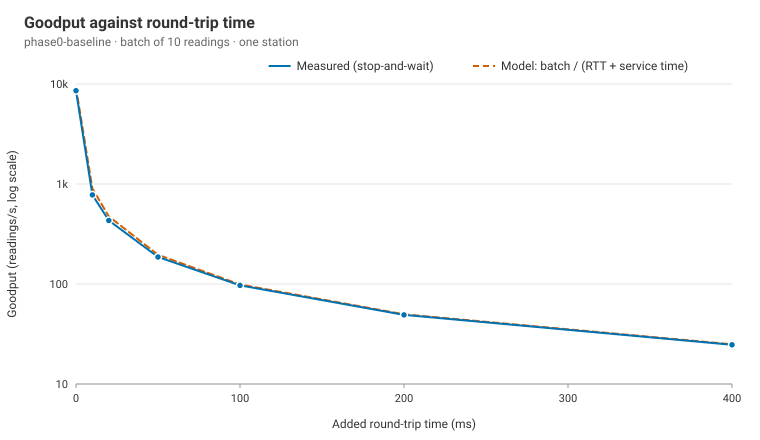
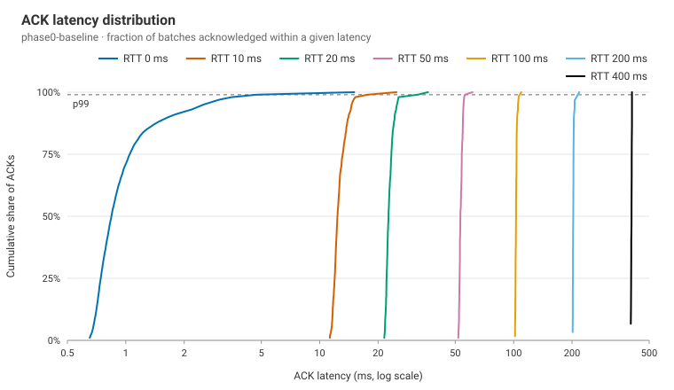
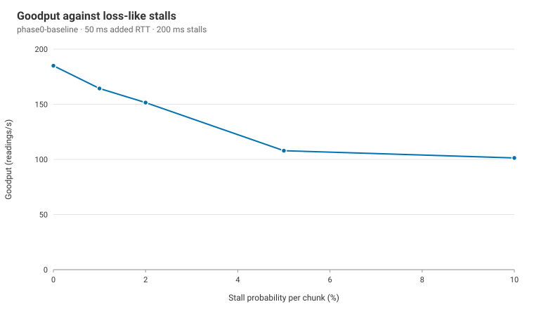
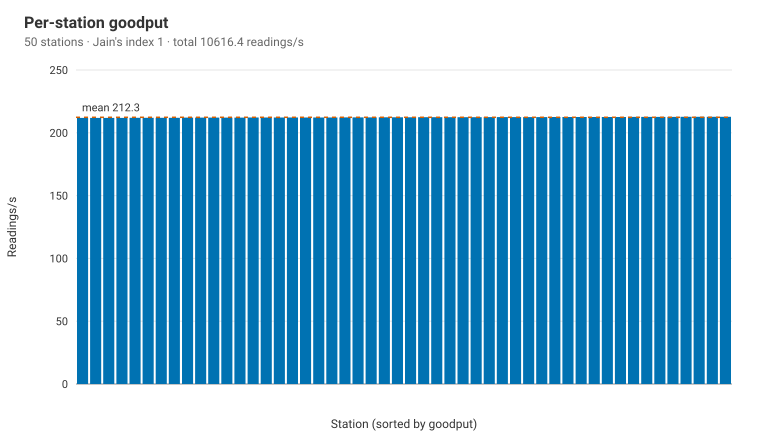

# Network lab results: phase0-baseline

Recorded 2026-11-14T16:59:54+00:00 on Python 3.12.16, Linux-6.6.87.2-microsoft-standard-WSL2-x86_64-with-glibc2.41 (SQLite 3.46.1). Git revision `ed05333-dirty`.

Generated by `scripts/netlab.py`. Impairments come from `scripts/impair_proxy.py`, an application-level TCP proxy on loopback: latency, jitter and rate caps are applied to the byte stream, and loss is modelled as a stall of one retransmission timeout. No packet is actually dropped, so TCP congestion-window effects are not reproduced.

## Goodput against round-trip time (one station, stop-and-wait)

Batches of 10 readings sent back to back. Model = batch size / (added RTT + ACK time measured on the unimpaired link).

| Added RTT (ms) | Readings/s | Model readings/s | ACK p50 (ms) | ACK p95 (ms) | ACK p99 (ms) |
|---:|---:|---:|---:|---:|---:|
| 0 | 8564.7 | 9199.63 | 0.843 | 2.517 | 4.749 |
| 10 | 778.2 | 901.96 | 12.344 | 14.606 | 17.704 |
| 20 | 431.75 | 474.23 | 22.632 | 25.023 | 32.049 |
| 50 | 186.03 | 195.74 | 53.128 | 55.165 | 56.114 |
| 100 | 96.75 | 98.92 | 102.922 | 105.808 | 109.574 |
| 200 | 49.07 | 49.73 | 202.908 | 206.464 | 218.091 |
| 400 | 24.66 | 24.93 | 405.311 | 407.749 | 407.749 |

## Goodput against loss-like stalls

Added RTT 50 ms. Each forwarded chunk stalls for 200 ms with the given probability.

| Stall probability | Readings/s | ACK p50 (ms) | ACK p99 (ms) |
|---:|---:|---:|---:|
| 0 | 184.97 | 53.45 | 56.828 |
| 0.01 | 164.35 | 54.478 | 255.166 |
| 0.02 | 151.52 | 52.551 | 452.546 |
| 0.05 | 107.87 | 52.357 | 453.015 |
| 0.1 | 101.34 | 52.907 | 452.954 |

## Fairness across stations

50 stations at once, added RTT 20 ms, 10 s.

- Total goodput: 10616.41 readings/s
- Per station: min 211.85, median 212.38, max 212.74 readings/s
- Jain's fairness index: 1.0
- ACK latency p50 / p99: 43.633 / 93.601 ms
- Server: write queue depth max 40, mean commit 0.929 ms, backpressure replies 0

## Recovery after a partition

The real `station_client/client.py` process sending 5 readings every 0.2 s. `blackhole` silently stops delivery (bytes are held, as with a dead link); `reset` aborts the connections.

| Mode | Outage (s) | Detected after (s) | First write after heal (s) | Backlog flushed after heal (s) | Missing seqs | Replayed duplicates | Samples not taken |
|---|---:|---:|---:|---:|---:|---:|---:|
| reset | 5 | 0.078 | 0.258 | 0.277 | 0 | 0 | 12 |
| blackhole | 5 | 2.076 | 0.051 | 0.01 | 0 | 5 | 80 |

Missing seqs counts gaps in what the station generated (data loss). Samples not taken counts readings the station never generated because sampling shares a loop with sending and stalls while a reply is awaited. First-write times come from polling the database every 50 ms.

